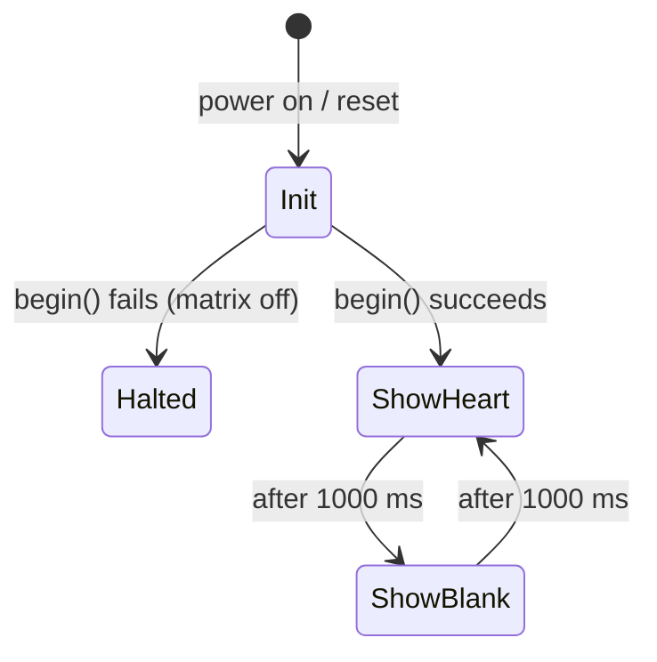
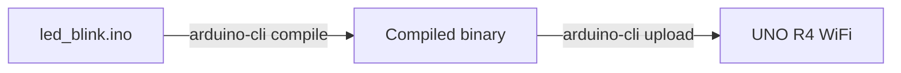

# Design Document

## Overview

The Blink_Sketch is a single Arduino sketch (`led_blink.ino`) for the Arduino UNO R4 WiFi. It initializes the built-in 12x8 LED_Matrix with the bundled `Arduino_LED_Matrix` library, then loops forever: show the Heart_Frame for 1000 ms, show the Blank_Frame for 1000 ms.

Design decisions:

- **Frame format: `uint8_t[8][12]` bitmap, shown with `renderBitmap`.** The bitmap is readable in source, so the heart shape is visible in the code. Alternative: packed `uint32_t[3]` with `loadFrame`, which is compact but unreadable. The readable form wins because the frame is tiny. (Requirements 1.1)
- **Timing with `delay(1000)`.** Nothing else runs in the sketch, so blocking delays are the simplest approach and meet the ±50 ms tolerance. (Requirements 1.3, 1.4)
- **Blank frame via `clear()`.** The library provides `clear()`, which loads an all-off frame. (Requirement 1.4)
- **Init failure: halt with matrix off.** `begin()` returns an `int` in the installed core (renesas_uno 1.6.0), nonzero on success. On failure the sketch does not render and parks in an empty loop. (Requirement 1.7)
- **Build via `arduino-cli`.** Two steps, compile then upload, with no test step. (Requirements 2, 3)

Source for the library API: `~/Library/Arduino15/packages/arduino/hardware/renesas_uno/1.6.0/libraries/Arduino_LED_Matrix/src/Arduino_LED_Matrix.h` (`begin()`, `renderBitmap`, `clear()`).

## Architecture





## Components and Interfaces

### Blink_Sketch (`led_blink/led_blink.ino`)

| Element | Responsibility |
|---|---|
| `#include "Arduino_LED_Matrix.h"` | Uses the bundled library (Req 2.2). |
| `ArduinoLEDMatrix matrix;` | Library object controlling the LED_Matrix. |
| `const uint8_t heartFrame[8][12]` | Heart_Frame, 8 rows by 12 columns, 1 = on. |
| `setup()` | Calls `matrix.begin()`. On failure sets a `matrixReady = false` flag. |
| `loop()` | If not ready, return immediately (matrix stays off). Otherwise `renderBitmap(heartFrame, 8, 12)`, `delay(1000)`, `matrix.clear()`, `delay(1000)`. |

Heart_Frame (rows top to bottom):

```
0 0 0 0 0 0 0 0 0 0 0 0
0 0 1 1 0 0 0 0 1 1 0 0
0 1 1 1 1 0 0 1 1 1 1 0
0 1 1 1 1 1 1 1 1 1 1 0
0 0 1 1 1 1 1 1 1 1 0 0
0 0 0 1 1 1 1 1 1 0 0 0
0 0 0 0 1 1 1 1 0 0 0 0
0 0 0 0 0 1 1 0 0 0 0 0
```

Note: `renderBitmap` is a macro that takes the array by name (`&bitmap[0][0]`), so the array must be passed directly, not through a pointer.

### Build_Toolchain (`arduino-cli`)

Fully qualified board name (FQBN): `arduino:renesas_uno:unor4wifi`.

1. `arduino-cli compile --fqbn arduino:renesas_uno:unor4wifi led_blink`
2. `arduino-cli board list` to find the port, then `arduino-cli upload -p <port> --fqbn arduino:renesas_uno:unor4wifi led_blink`

Behavior rules:
- The upload runs only if the compile exits 0 (Req 2.7, 3.3).
- If no UNO R4 WiFi is listed, the upload is not started and an error is reported (Req 2.5).
- Upload is wrapped in a 60 s timeout, with no automatic retry (Req 2.6, 3.4).
- Compile and upload failures name the failing step (Req 3.3, 3.4). A small shell script (`build.sh`) may chain the steps and print the step name on failure. It runs exactly two steps and no tests (Req 3.2).

## Data Models

- `heartFrame`: `const uint8_t[8][12]`, values 0 or 1. 96 pixels, with more than 0 and fewer than 96 lit (Req 1.1).
- `matrixReady`: `bool`, set once in `setup()` from the `begin()` result.

No persistent state.

## Error Handling

| Condition | Handling |
|---|---|
| `matrix.begin()` returns failure | No frame is rendered, `loop()` does nothing, all pixels stay off (Req 1.7). |
| Compile error | `arduino-cli` prints file and line; upload skipped; non-zero exit; report says "compile" failed (Req 2.7, 3.3). |
| No board detected | Upload not started; "no board found" message; non-zero exit (Req 2.5). |
| Upload fails or exceeds 60 s | Upload stopped; failure reason reported; non-zero exit; no retry (Req 2.6, 3.4). |

## Testing Strategy

Automated testing is out of scope by the user's instruction (Req 3.1). The project contains no test files or test-framework configuration, and the build runs compile then upload only (Req 3.2).

Property-based testing does not apply. The sketch is hardware-driven, timing-based, side-effect-only code with a fixed constant frame, and there is no meaningful "for all inputs" statement. For that reason this document has no Correctness Properties section.

Verification is manual:
- Compile succeeds with zero errors (Req 2.3).
- After upload, watch the board: a heart appears for about 1 s, then the matrix is blank for about 1 s, repeating (Req 1.3 to 1.6).
