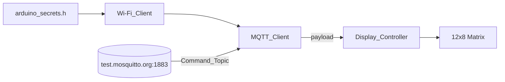
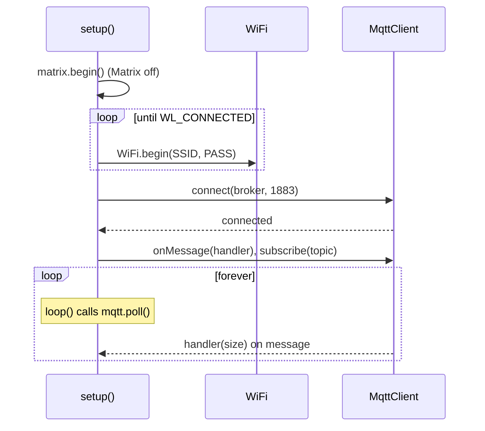

# Design Document

## Overview

The existing led_blink sketch is changed from a self-running blinking heart into an MQTT-controlled display. At startup the Board connects to Wi-Fi, connects once to the Broker test.mosquitto.org on port 1883, and subscribes to `bandungsoda/kiro/led/command`. The payload `HEART` or `SMILE` selects the frame shown on the Matrix. Any other payload is ignored.

Scope decisions, taken from the requirements:

- No logging, no automated tests, no MQTT reconnection. The sketch connects to MQTT once. If that connection fails, the Matrix stays off and the sketch only idles.
- Wi-Fi credentials live in a git-ignored header, with a committed example file.
- `build.sh` is extended with a library install step and a secrets check. The existing compile and upload logic (port detection, 60 s upload timeout) is kept.

Research summary (library APIs used):

- `WiFiS3` ships with the `arduino:renesas_uno` core, so only `ArduinoMqttClient` needs installing. It provides `MqttClient` with `connect(host, port)`, `subscribe(topic)`, `onMessage(callback)`, `poll()`, `messageTopic()`, `available()` and `read()`.
- `Arduino_LED_Matrix.h` (already used) provides `ArduinoLEDMatrix::begin()`, `renderBitmap(frame, 8, 12)` and `clear()`.

## Architecture

All logic stays in a single file, `led_blink/led_blink.ino`, split into small functions. The control flow is linear: `setup()` brings up the Matrix, Wi-Fi and MQTT in order; `loop()` only polls the MQTT client, which invokes a callback per message.



Startup sequence:



## Components and Interfaces

### Secrets files

- `led_blink/led_blink/arduino_secrets.h` (git-ignored) defines:
  ```cpp
  #define SECRET_SSID "your-ssid"
  #define SECRET_PASS "your-password"
  ```
- `led_blink/led_blink/arduino_secrets.h.example` (committed) has the same two defines with placeholder values.
- `.gitignore` at the repository root gets the line `led_blink/led_blink/arduino_secrets.h`. The `.example` file does not match this entry, so it stays tracked.

### Sketch (`led_blink.ino`)

| Element | Responsibility | Requirements |
| --- | --- | --- |
| `connectWifi()` | Calls `WiFi.begin(SECRET_SSID, SECRET_PASS)` and repeats until `WiFi.status() == WL_CONNECTED`, with a short delay between attempts. | 1.1, 1.2, 4.1 |
| `connectMqtt()` | Calls `mqtt.connect("test.mosquitto.org", 1883)` once. On success, registers `onMessage(handleMessage)` and calls `mqtt.subscribe("bandungsoda/kiro/led/command")`. Returns a bool. | 2.1, 2.2 |
| `handleMessage(int size)` | Reads `size` bytes of the payload into a `String` and passes it to `applyCommand()`. | 2.3 |
| `applyCommand(const String&)` | Display_Controller. `"HEART"` renders Heart_Frame, `"SMILE"` renders Smile_Frame, any other value does nothing. | 3.1, 3.2, 3.3 |
| `setup()` | `matrix.begin()`, `connectWifi()`, `connectMqtt()`. Does not render a frame. | 3.5 |
| `loop()` | Calls `mqtt.poll()` when MQTT connected; otherwise returns. No rendering, so the last frame persists. | 3.4 |

Globals: `ArduinoLEDMatrix matrix`, `WiFiClient wifiClient`, `MqttClient mqtt(wifiClient)`, `bool mqttReady`, `heartFrame[8][12]` and `smileFrame[8][12]`.

Libraries included: `WiFiS3.h`, `ArduinoMqttClient.h`, `Arduino_LED_Matrix.h`, `arduino_secrets.h`.

### Build_Script (`led_blink/build.sh`)

The script runs these steps in order, exiting with non-zero status on any failure:

1. Secrets check: if `$SKETCH_DIR/arduino_secrets.h` does not exist, print to stderr a message naming `arduino_secrets.h.example` (copy it to `arduino_secrets.h` and fill in values) and `exit 1`. (5.4)
2. `arduino-cli lib install ArduinoMqttClient`. (5.1)
3. `arduino-cli compile --fqbn arduino:renesas_uno:unor4wifi "$SKETCH_DIR"`. Failure exits 1. (5.2, 5.5)
4. Existing port detection and `arduino-cli upload` with the 60 s timeout. Failure exits 1. (5.3, 5.5)

Step counters in the echo messages change from "1/2" and "2/2" to cover the new steps. The rest of the script is unchanged.

## Data Models

Frames are `uint8_t[8][12]` arrays, one byte per pixel (1 = on), rows top to bottom. They are not `const` because `renderBitmap` takes a non-const pointer. The existing heart bitmap is reused unchanged.

Smile_Frame:

```cpp
uint8_t smileFrame[8][12] = {
  {0, 0, 0, 0, 0, 0, 0, 0, 0, 0, 0, 0},
  {0, 0, 0, 1, 1, 0, 0, 1, 1, 0, 0, 0},
  {0, 0, 0, 1, 1, 0, 0, 1, 1, 0, 0, 0},
  {0, 0, 0, 0, 0, 0, 0, 0, 0, 0, 0, 0},
  {0, 1, 0, 0, 0, 0, 0, 0, 0, 0, 1, 0},
  {0, 0, 1, 0, 0, 0, 0, 0, 0, 1, 0, 0},
  {0, 0, 0, 1, 1, 1, 1, 1, 1, 0, 0, 0},
  {0, 0, 0, 0, 0, 0, 0, 0, 0, 0, 0, 0}
};
```

Constants: broker host `test.mosquitto.org`, port `1883`, topic `bandungsoda/kiro/led/command`. Commands are compared as exact, case-sensitive strings.

## Error Handling

- Wi-Fi connect failure: `connectWifi()` retries until it succeeds (1.2). The Matrix stays off meanwhile.
- MQTT connect failure: `connectMqtt()` returns false, `mqttReady` stays false, and `loop()` idles. There is no retry or reconnection (out of scope).
- Matrix init failure: `matrix.begin()` returning 0 leaves the display unusable, so `applyCommand()` does nothing when the Matrix is not ready (same guard as the current sketch).
- Unknown payload: ignored, Matrix content unchanged (3.3).
- Missing secrets file: caught by `build.sh` before compiling (5.4). Without it, the compiler would also fail on the missing include.
- Compile or upload failure: `build.sh` exits 1 (5.5).

## Testing Strategy

Per the user's scope, there are no automated tests and no logging. Property-based testing does not apply: the sketch is hardware and network glue with a two-value command switch, so there is no meaningful input space to quantify over, and a Correctness Properties section is omitted.

Verification is limited to what `build.sh` does: it confirms the sketch compiles for `arduino:renesas_uno:unor4wifi` and uploads. Manual hardware verification is out of scope.
