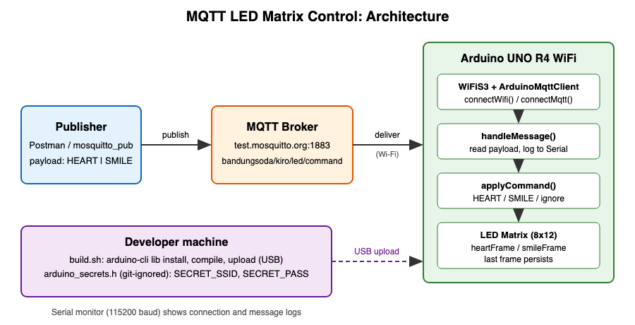

# 💖 MQTT LED Matrix Control

Send a word over the internet and watch your Arduino answer with a picture.
Publish `HEART` and the LED matrix shows a heart. Publish `SMILE` and it smiles back. 😄



## ✨ What it does

- Connects an **Arduino UNO R4 WiFi** to your Wi-Fi.
- Subscribes to an MQTT topic on the public broker `test.mosquitto.org`.
- Shows a **heart** or a **smiley** on the built-in 8x12 LED matrix when a matching message arrives.
- Keeps the last picture on screen until a new command comes in.
- Prints what it is doing to the Serial Monitor, so you can see why something works (or doesn't).

## 🧰 What you need

- Arduino UNO R4 WiFi and a USB cable
- A 2.4 GHz Wi-Fi network (name and password)
- [`arduino-cli`](https://arduino.github.io/arduino-cli/) with the `arduino:renesas_uno` core installed
- Any MQTT publisher: [Postman](https://www.postman.com/), `mosquitto_pub`, MQTTX, and so on

## 🚀 Quick start

**1. Add your Wi-Fi details.** Copy the example file and edit it:

```bash
cd led_blink
cp arduino_secrets.h.example arduino_secrets.h
```

Open `arduino_secrets.h` and set `SECRET_SSID` and `SECRET_PASS`.
This file is git-ignored, so your password stays on your machine. 🔒

**2. Build and upload.** Plug in the board, then run:

```bash
bash build.sh
```

The script installs the `ArduinoMqttClient` library, compiles the sketch, finds your board and uploads it.
If `arduino_secrets.h` is missing, the script stops and tells you what to do.

**3. Watch the logs** (optional, but handy):

```bash
arduino-cli monitor -p <your-port> -c baudrate=115200
```

Press the reset button on the board after the monitor opens to see the startup messages.

**4. Send a command.** 🎉

| Setting | Value |
| --- | --- |
| Broker | `test.mosquitto.org` |
| Port | `1883` (no TLS, no login) |
| Topic | `bandungsoda/kiro/led/command` |
| Payload | `HEART` or `SMILE` |

With `mosquitto_pub`:

```bash
mosquitto_pub -h test.mosquitto.org -p 1883 -t bandungsoda/kiro/led/command -m "HEART"
mosquitto_pub -h test.mosquitto.org -p 1883 -t bandungsoda/kiro/led/command -m "SMILE"
```

## 💬 Commands

| Payload | Result |
| --- | --- |
| `HEART` | ❤️ Heart on the matrix |
| `SMILE` | 🙂 Smiley on the matrix |
| anything else | Ignored, the matrix stays as it is |

Payloads are plain text and case-sensitive. `heart`, `"HEART"` and `HEART\n` will not match.

## 🔍 What the serial log tells you

| You see | It means |
| --- | --- |
| `Connecting to Wi-Fi SSID ...` repeating | Wrong SSID or password, or the network is out of range |
| `Wi-Fi connected, IP: ...` | Wi-Fi is fine |
| `MQTT connect failed, error ...` | The broker is unreachable. The sketch retries every 3 seconds |
| `MQTT connected, subscribed to ...` | Ready for commands |
| `Message received on ...` | Your publish arrived |
| `Unknown command, ignored` | The payload text did not match exactly |

## 🩹 Troubleshooting

- **Nothing happens when I publish.** Check the Serial Monitor first. If you never see `Message received`, the topic or broker settings in your publisher are off.
- **Postman.** Use an MQTT request (not HTTP) and the exact topic above.
- **Wi-Fi never connects.** The board supports 2.4 GHz networks only.
- **Upload fails.** Check the USB cable and that no Serial Monitor is holding the port.

## 🗂️ Project layout

```
led_blink/
├── docs/
│   ├── architecture.png        # the diagram above
│   └── architecture.svg
├── led_blink/
│   ├── led_blink.ino           # the sketch
│   ├── arduino_secrets.h.example
│   ├── arduino_secrets.h       # your credentials (git-ignored)
│   └── build.sh                # install library, compile, upload
└── .kiro/specs/mqtt-led-matrix-control/   # requirements, design, tasks
```

## ⚠️ Good to know

`test.mosquitto.org` is a public broker. Anyone who knows your topic can publish to it,
so pick a topic of your own if you share your setup. To change it, edit the topic string in
`connectMqtt()` in `led_blink.ino` and upload again.

Have fun, and send someone a heart. 💖
