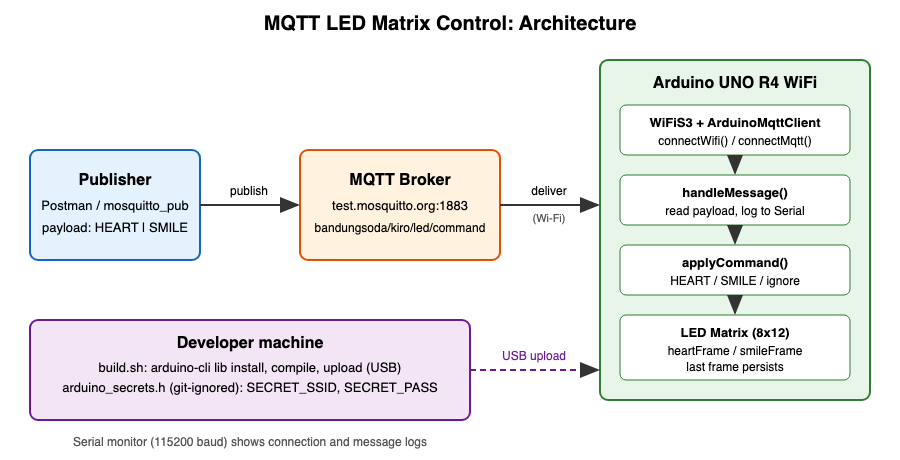

# I sent a heart to my Arduino over the internet

*Control the LED matrix on an Arduino UNO R4 WiFi with MQTT, build it with Kiro and arduino-cli, and learn what to do when nothing happens.*

<!-- TODO: add a short video or GIF here: publish HEART in Postman, heart appears on the board. -->

You publish a single word. A few hundred milliseconds later, a heart lights up on a board on your desk.

In this post you will build exactly that:

- Publish `HEART` and the Arduino shows a heart.
- Publish `SMILE` and it shows a smiley.
- Publish anything else and it ignores you politely.

I built it with [Kiro](https://kiro.dev) (spec first, then code) and `arduino-cli`, so there is no Arduino IDE anywhere. I also hit a bug where I published a message and **nothing happened**. That part taught me the most, so it gets its own section.

The full code is in the repo: **[add your repo link here]**.

## What you'll need

- An **Arduino UNO R4 WiFi** and a USB cable
- A **2.4 GHz** Wi-Fi network (the board does not support 5 GHz)
- [`arduino-cli`](https://arduino.github.io/arduino-cli/) with the `arduino:renesas_uno` core installed
- An MQTT publisher: [Postman](https://www.postman.com/), `mosquitto_pub`, or MQTTX

## The big picture



Three players are involved:

1. **The publisher** (Postman or `mosquitto_pub`) sends a short text message.
2. **The broker** (`test.mosquitto.org`) receives it and passes it to everyone who subscribed to that topic.
3. **The board** joined Wi-Fi, subscribed to the topic, and draws a picture when a message arrives.

The publisher and the board never talk to each other directly. They only know the broker and the topic name.

## MQTT in two minutes

MQTT is a small messaging protocol made for devices like this one. It has three ideas:

- **Topic:** a name for a channel, like `bandungsoda/kiro/led/command`.
- **Publish:** send a message to a topic.
- **Subscribe:** tell the broker you want every message sent to a topic.

Think of a mail room. You drop a letter in the box labelled with a topic, and the mail room hands a copy to everybody who asked for that label.

One warning: `test.mosquitto.org` is a **public** broker. It needs no login, and anyone who guesses your topic can publish to it. That is fine for a demo. Pick an unusual topic name, and add TLS and authentication before you use this for anything real.

## Step 1: keep your Wi-Fi password out of git

The sketch reads the Wi-Fi name and password from a header file that git never sees.

```bash
cd led_blink
cp arduino_secrets.h.example arduino_secrets.h
```

Then edit `arduino_secrets.h`:

```cpp
#define SECRET_SSID "your-ssid"
#define SECRET_PASS "your-password"
```

The repo commits only the `.example` file. `.gitignore` lists the real one, so your password stays on your machine.

## Step 2: the sketch, piece by piece

The whole sketch is one file, `led_blink.ino`. Here are the four parts that matter.

### Joining Wi-Fi

```cpp
void connectWifi() {
  while (WiFi.status() != WL_CONNECTED) {
    Serial.print("Connecting to Wi-Fi SSID '");
    Serial.print(SECRET_SSID);
    Serial.println("'...");
    WiFi.begin(SECRET_SSID, SECRET_PASS);
    delay(2000);
  }
  Serial.print("Wi-Fi connected, IP: ");
  Serial.println(WiFi.localIP());
}
```

It tries every 2 seconds until it succeeds. The log prints the network name, never the password.

### Connecting to the broker and subscribing

```cpp
bool connectMqtt() {
  if (!mqtt.connect("test.mosquitto.org", 1883)) {
    Serial.print("MQTT connect failed, error ");
    Serial.println(mqtt.connectError());
    return false;
  }
  mqtt.onMessage(handleMessage);
  mqtt.subscribe("bandungsoda/kiro/led/command");
  return true;
}
```

`onMessage` registers a callback. The library calls `handleMessage` every time a message arrives on a topic you subscribed to.

### Reading the message and choosing a picture

```cpp
void applyCommand(const String& cmd) {
  if (!matrixReady) return;
  if (cmd == "HEART") {
    matrix.renderBitmap(heartFrame, 8, 12);
  } else if (cmd == "SMILE") {
    matrix.renderBitmap(smileFrame, 8, 12);
  }
  // Anything else is ignored; the matrix stays as it is.
}
```

The match is exact and case-sensitive. `heart` does nothing.

### Drawing a frame

The LED matrix is 12 columns by 8 rows. A picture is just an array of bytes where 1 means "light on":

```cpp
uint8_t smileFrame[8][12] = {
  {0, 0, 0, 0, 0, 0, 0, 0, 0, 0, 0, 0},
  {0, 0, 0, 1, 1, 0, 0, 1, 1, 0, 0, 0},
  {0, 0, 0, 1, 1, 0, 0, 1, 1, 0, 0, 0},
  {0, 0, 0, 0, 0, 0, 0, 0, 0, 0, 0, 0},
  {0, 1, 0, 0, 0, 0, 0, 0, 0, 0, 1, 0},
  {0, 0, 1, 0, 0, 0, 0, 0, 0, 1, 0, 0},
  {0, 0, 0, 1, 1, 1, 1, 1, 1, 0, 0, 0},
  {0, 0, 0, 0, 0, 0, 0, 0, 0, 0, 0, 0}
};
```

Squint and you can see the face. Want your own picture? Draw it in this grid and add a new `if` in `applyCommand()`.

## Step 3: build and upload without the Arduino IDE

One script does everything:

```bash
bash build.sh
```

It runs three steps: install the `ArduinoMqttClient` library, compile for `arduino:renesas_uno:unor4wifi`, and upload to the board it finds on USB. If `arduino_secrets.h` is missing, it stops and tells you to copy the example file.

> **Gotcha:** `build.sh` sits next to the sketch, in `led_blink/led_blink/`. I ran it from the wrong folder twice.

## Step 4: send a command

| Setting | Value |
| --- | --- |
| Broker | `test.mosquitto.org` |
| Port | `1883` (no TLS, no login) |
| Topic | `bandungsoda/kiro/led/command` |
| Payload | `HEART` or `SMILE` |

```bash
mosquitto_pub -h test.mosquitto.org -p 1883 -t bandungsoda/kiro/led/command -m "HEART"
```

In Postman, use an **MQTT request**, not an HTTP one. The payload is plain text, with no quotes and no trailing newline.

## When nothing happens

My first version compiled and uploaded cleanly. Then I published `HEART` from Postman and the matrix stayed dark.

That was the problem: **I had no idea why**. The board could be stuck on Wi-Fi, the broker connection could have failed, or the message might never have arrived. From the outside they all look identical.

So I added a serial log. The sketch now prints each step:

```
Starting
Matrix ready: yes
Connecting to Wi-Fi SSID 'MyNetwork'...
Wi-Fi connected, IP: 192.168.1.42
Connecting to MQTT test.mosquitto.org:1883...
MQTT connected, subscribed to bandungsoda/kiro/led/command
Message received on 'bandungsoda/kiro/led/command', size 5
Command: 'HEART'
Rendered HEART
```

<!-- TODO: replace the sample above with your own real serial output. -->

Open it with:

```bash
arduino-cli monitor -p <your-port> -c baudrate=115200
```

Press the board's reset button after the monitor opens so you catch the startup lines. Then read the log like a checklist:

| You see | It means |
| --- | --- |
| `Connecting to Wi-Fi SSID ...` repeating | Wrong SSID or password, or out of range |
| `Wi-Fi connected, IP: ...` | Wi-Fi is fine |
| `MQTT connect failed, error ...` | The broker is unreachable |
| `MQTT connected, subscribed to ...` | Ready for commands |
| `Message received on ...` | Your publish arrived |
| `Unknown command, ignored` | The text did not match exactly |

I also added reconnect logic. `loop()` now checks Wi-Fi and the MQTT connection on every pass. If either has dropped, it logs `Wi-Fi lost`, reconnects, and subscribes again. The first version connected to the broker once, and a single failed attempt at boot would have left the board deaf with no way to recover.

## How Kiro fit in

I did not start with code. Kiro's spec workflow produced three documents first:

1. **Requirements:** what the board must do, written as testable statements. For example, "WHEN the Display_Controller receives the Command HEART, THE Display_Controller SHALL render the Heart_Frame on the Matrix."
2. **Design:** the functions, the data and how errors are handled.
3. **Tasks:** a checklist of small steps, each pointing back to a requirement.

Kiro then ran the tasks one by one, and an auto-commit hook saved a commit as each piece landed. The git log reads like a diary of the build: secrets file, `.gitignore`, build script, connection helpers, message handling, `setup()` and `loop()`.

<!-- TODO: add screenshots of requirements.md, tasks.md and the git log. -->

### Where the spec and the code disagreed

The first spec said, in plain words: **no logging, no reconnection**. I had scoped the project small on purpose. Then the board went silent, and I added both anyway.

The code was now better than the spec described. I only noticed when I went looking for where "add serial log" was written down, and it wasn't. I updated the requirements, design and tasks to match, and committed that as its own change.

What I would do differently: for any project that runs on hardware, put logging in the first spec. A device with no screen needs some way to tell you what it is doing.

## The prompts I used

Here are the prompts I gave Kiro, in order, lightly cleaned up for typos. You can reuse them as a script for your own build. I grouped them by phase and noted what each one produced, using the commits in the repo.

### Phase 0: the warm-up, a blinking heart

Before MQTT, I started with the simplest possible sketch: a heart that blinks on the built-in LED matrix. These are the prompts, word for word.

> Develop an Arduino application to display a blinking heart animation on the built-in 12×8 LED Matrix of the Arduino UNO R4 WiFi. The heart should appear for 1 second, disappear for 1 second, and repeat continuously.
>
> Do not perform testing. Please upload compile code in arduino.

Kiro asked whether this was a feature or a bug fix, then wrote the requirements: the blink timing, the compile and upload steps, and an explicit "no automated tests" rule that came straight from my second sentence.

> Create the design for blinking-heart-led-matrix

This produced the design: one sketch file, the heart stored as a 12×8 bitmap, and a loop of show, wait 1 second, clear, wait 1 second.

> Create the tasks for blinking-heart-led-matrix

This produced the task list: write the sketch, write a build script, then compile and upload.

> Run all required tasks

Kiro queued the remaining tasks and ran them one at a time. The first compile failed, because `renderBitmap` needs a non-const array. Kiro removed `const` from the heart frame, recompiled and uploaded.

Notice how much the spec did for me. Each prompt is one line, because the previous document already held the detail.

### Phase 1: write the spec

The first prompts created the requirements, design and task list for the MQTT feature. They became three commits: requirements, design and tasks.

This is the prompt that started the MQTT feature, lightly cleaned up. Kiro first asked whether this was a new feature or a bug fix, then whether to start from requirements or from the design.

> Modify the current code. The Arduino must connect to a Wi-Fi network and an MQTT broker, subscribe to the topic `bandungsoda/kiro/led/command`, and control its built-in 12×8 LED matrix based on received messages. The application must support two MQTT commands:
> - `HEART`: display a heart
> - `SMILE`: display a smiley face
>
> The entire development process, including requirements, design, implementation, compilation, and firmware upload, must use Kiro and Arduino CLI without the Arduino IDE.
>
> Exclude MQTT connection handling, automatic reconnection, and manual hardware verification.
>
> Keep Wi-Fi credentials outside version-controlled source files.
>
> Please keep it simple. No logging. No testing. Just connect to the test.mosquitto broker.

Kiro wrote the requirements and stopped. It chose the `ArduinoMqttClient` library on its own and said so, and it kept a Wi-Fi retry loop at startup, which it explained is separate from the MQTT reconnection I had excluded. Then I approved each document with a short prompt:

> proceed to design

> please write task

Kiro asked for a review after each document, so the whole spec took three prompts after the first one.

> Run all required tasks

This one runs the task list, the same as in the warm-up.

Look at the constraints in the first prompt. "No logging" and "exclude reconnection" are the same two scope cuts that I later reversed (see *Where the spec and the code disagreed*). If your device has no screen, leave those two lines out.

### Phase 2: build it

> Run all required tasks

Kiro worked through the task list, one sub-agent per task. It produced six commits in about four minutes: the secrets example file, the `.gitignore` entry, the build script changes, the connection helpers, message handling, and `setup()` and `loop()`.

### Phase 3: test, then debug

> What is the format to publish data to the Arduino board?

Kiro answered with the broker, port, topic and the two payloads, plus a `mosquitto_pub` example.

> I have changed the SSID and password, please recompile the code again

This rebuilt and uploaded the sketch with the real credentials.

> Nothing happens when I publish via Postman, please add log via serial

This added the serial log and the reconnect logic. It is the turning point of the story above.

> Recompile and upload the code to the Arduino again

> Commit the code with a relevant commit message

### Phase 4: document

> Add an image that illustrates the architecture of this project

This produced `docs/architecture.svg` and a PNG copy.

> Add also a README for this project and include this image in the README. Make it user-friendly and fun for the user to read.

> Yes, please commit

### Phase 5: review the process

> Please analyze all prompts in the session according to the git commit history

Kiro mapped the commits to five phases and noticed the long gap between the first upload and the first real test.

> What is "verify on hardware"?

> Is adding the serial log written in any design or requirements?

This was the question that exposed the drift: the spec said "no logging", but the code logged.

> Please update the spec to match the code

> Please commit the current changes

### Phase 6: write about it

> I want to make a tutorial in Substack for this repo. Please suggest the content.

> Draft the full post in Markdown

> Commit the first draft Substack post

> Please add all the relevant Kiro prompts from the whole session history to the Substack post.

### What I learned about prompting

- **Short prompts worked** because the spec already held the detail. "Run all required tasks" is a single line, and the task list did the rest.
- **Describe the symptom, not the fix.** "Nothing happens when I publish" would have been enough. I also asked for the serial log, which was the right call.
- **Ask Kiro to check its own work against the spec.** The question about where logging was written down caught a mismatch I would have missed.
- **Ask for a commit at the end of each step.** The history became the outline for this post.

## Ideas to take it further

- Add more commands: `STAR`, `ARROW`, or a blank frame to turn the matrix off.
- Show scrolling text from the message payload.
- Switch to your own broker (Mosquitto in Docker works well) and add a username and password.
- Use TLS on port 8883.
- Publish from a script, a cron job or Home Assistant, so a real event (a build finishing, a doorbell) lights up the board.

## Wrap-up

You now have a board that listens to the internet and answers with a picture, a build that needs only `arduino-cli`, and a way to see what the board is doing when it stays quiet.

The code is here: **[add your repo link here]**. If you build your own version, reply and tell me which picture you added first.

*Next time: [add teaser, such as securing the broker with TLS].*
